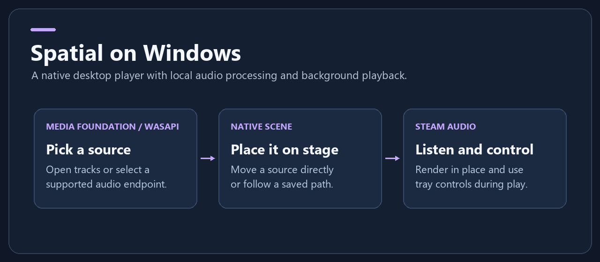

# Spatial Win

A native Windows spatial audio player with an x64 portable build and optional installer.

**Tech stack** · C++20 · Win32 · WASAPI · Media Foundation · Steam Audio · CMake · NSIS



## Spatial audio on Windows

Play local tracks or an available device-audio source, position sources in a virtual stage, and save spaces for later. The desktop edition processes audio on the PC and can stay in the Windows tray during playback.

| Path | Role |
| --- | --- |
| [`windows/main.cpp`](windows/main.cpp) | Native player, stage, audio pipeline, and tray behavior |
| [`windows/README.md`](windows/README.md) | Playback, device-audio modes, and saved spaces |
| [`shared/audio/`](shared/audio/) | Native audio engine and DSP shared with the Android edition |
| [`scripts/build-windows.ps1`](scripts/build-windows.ps1) | x64 compilation, portable ZIP, and optional NSIS installer |

## Downloads

| Windows x64 1.1.4 | Package |
| --- | --- |
| Installer | [Setup EXE](dist/Spatial-1.1.4-Windows-x64-Setup.exe) |
| Portable | [ZIP](dist/Spatial-1.1.4-Windows-x64.zip) |

Quit Spatial from the tray before updating. For the portable build, extract the whole ZIP before opening Spatial.exe. See the [package archive](dist/) and [SHA-256 checksums](dist/SHA256SUMS.txt).

## Build the Windows EXE

Install Visual Studio 2022 C++ Build Tools, the Windows SDK, and CMake. Install NSIS to build a Setup EXE in addition to the portable ZIP.

```powershell
.\scripts\bootstrap.ps1
.\scripts\build-windows.ps1
```

The build writes packages to `dist/`. Keep the Steam Audio runtime beside `Spatial.exe` when using the portable build.

## Tests and verification

After building, open the portable app, play a local track, move it on the stage, and check a saved space reload. Close the app to the tray and test Stop and Quit. Device-audio behavior depends on the Windows version, source application, and audio endpoint.

## License

The project code is available under the [MIT License](LICENSE).

The bundled components and test assets include their own notices.

- [Steam Audio license](licenses/STEAM-AUDIO-LICENSE.txt)
- [Steam Audio third-party notices](licenses/STEAM-AUDIO-THIRDPARTY.txt)
